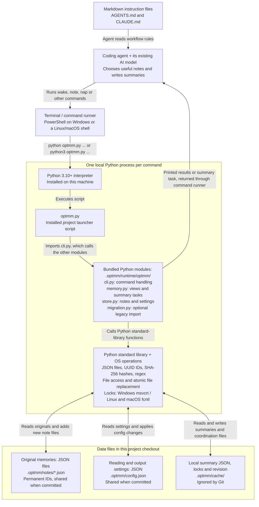
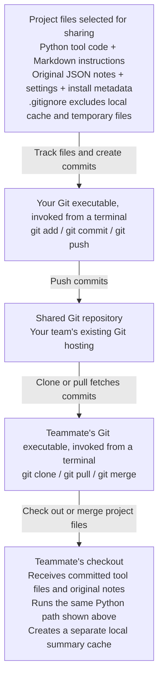
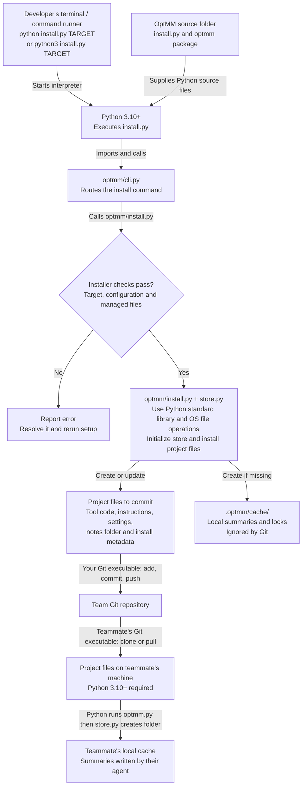

# OptMM

Shared project memory for coding agents. Original memories have permanent IDs and
live in separate files, so teammates can add notes on different branches and merge
them with normal Git workflows. Summaries are local, replaceable caches.

**Requires Python 3.10+ only.** No pip packages, database, server, API key, Git hook,
or global agent configuration. Your existing coding agent writes the summaries.

For a teammate walkthrough, start with [the architecture diagrams](#architecture-how-the-pieces-fit-together).

## Install into a project

Run **`install.py` once for each project repository** that should use shared memory.
On this machine, the installer is at:

```text
A:\Claude\opt-mem2\install.py
```

The argument is the **root directory of your existing project repository**: the
folder containing that project's `.git` entry. `A:\Claude\YourProject` below is an
example; replace it with your actual project path. Keep the entire OptMM source
folder together while installing. The installed project is self-contained afterward.

### 1. Run the installer

On Windows, run this in PowerShell from any directory. Confirm the version is
Python 3.10 or newer:

```powershell
python --version
python "A:\Claude\opt-mem2\install.py" "A:\Claude\YourProject"
```

If Windows provides Python through `py -3`, use that in place of `python` in these
commands. The target directory must already exist.

On Ubuntu or WSL, use Linux Python and replace these paths with the locations of
your OptMM checkout and target project:

```sh
python3 --version
python3 "/home/you/opt-mem2/install.py" "/home/you/your-project"
```

To use this machine's existing Windows source folder from WSL, if `A:` is mounted
at `/mnt/a`, the equivalent command is:

```sh
python3 "/mnt/a/Claude/opt-mem2/install.py" "/home/you/your-project"
```

For WSL, keeping the project in the Linux filesystem (for example, under `/home/you`)
improves file-access performance compared with a mounted Windows drive such as
`/mnt/c` or `/mnt/a`. See Microsoft's [WSL filesystem guidance](https://learn.microsoft.com/en-us/windows/wsl/filesystems).

The installer adds:

```text
your-project/
  optmm.py                      Portable entry point
  AGENTS.md                     Managed memory instructions, existing text preserved
  CLAUDE.md                     Same integration for Claude-compatible agents
  .gitignore                    Ignore rules for generated files
  .optmm/
    config.json                 Shared reading/output budgets
    install.json                Runtime checksums for safe upgrades
    README.md                   Store documentation
    runtime/optmm/              Vendored Python runtime
    notes/<permanent-id>.json   Shared original memories
    cache/                      Local summaries and locks; ignored by Git
```

### 2. Verify it inside your project

On Windows:

```powershell
cd "A:\Claude\YourProject"
python optmm.py check
python optmm.py wake
```

On Ubuntu or WSL:

```sh
cd "/home/you/your-project"
python3 optmm.py check
python3 optmm.py wake
```

`check` should report `OK`. A newly installed, empty store should say `No memories
yet.` and `You are awake.` If the project already has memories and requests `nap`
tasks, have your coding agent complete them and run `wake` again.

Start a new coding-agent session in the project so it reads the installed
`AGENTS.md` or `CLAUDE.md` instructions. Those instructions tell it to read memory,
record useful discoveries, and write requested summaries.

### 3. Commit the installation and share it

From the target project's root, review and commit the installed files:

```sh
git status --short
git add optmm.py .optmm .gitignore AGENTS.md CLAUDE.md
git diff --cached
git commit -m "Add shared project memory"
```

Share that commit through your normal push or pull-request workflow. The installer
does not commit or push for you. The generated `.gitignore` rules exclude the local
cache and temporary files.

### 4. Teammates clone or pull, then use memory

**After the setup commit is shared, teammates just clone/pull the project.** They do not need this
OptMM source checkout, pip, a setup command, environment variables, or Git config.
They need Python 3.10+ available to their coding agent. From their project root,
the agent runs `python optmm.py wake` (`python3 optmm.py wake` on Ubuntu/WSL);
the local cache is created on first use.
The installed launcher also works by absolute path from another working directory.

### Choose which agent instructions to install

By default both instruction files are updated. Choose a different integration with:

```sh
python install.py /path/to/project --instructions agents
python install.py /path/to/project --instructions claude
python install.py /path/to/project --instructions none
```

Run these examples from the OptMM source folder, or replace `install.py` with its
full path as above. If you choose fewer instruction files, include only the files
that were actually updated in the setup commit. With `--instructions none`, add
the memory workflow to your agent's own instructions yourself.

Existing text outside the marked OptMM blocks is preserved. The marked blocks
belong to the installer and are refreshed on upgrade; put team customizations
outside them. Malformed markers and conflicting or locally modified runtime files
cause installation to stop with an explanation instead of silently overwriting.
Runtime checksum checks tolerate Git's LF/CRLF line-ending conversions.

## Architecture: how the pieces fit together

Think of an original memory as a short project note saved in a file. A summary is
a shorter overview of a group of those notes. The **coding agent decides what to
remember and writes summaries**, **Python runs the OptMM scripts that manage the
files**, and **Git shares committed project files with teammates**.

The views below cover setup, installed-project use and Git sharing in the current
implementation. Boxes name the actual
technologies, scripts and file locations. Arrows are labeled with the command,
call or data transfer they represent. The Python modules and standard-library
helpers run in one local Python process per command; they are not separate services.
The agent uses its existing AI model through its normal provider or local setup.
OptMM does not add a model API connection.

### Daily use: agent to Python to files

Read from the instructions through the agent and command runner, then follow the
Python execution path to the files. The return arrow carries either remembered
information or a task asking the agent to write a summary.



For example, the agent runs `python optmm.py note "Payments need idempotency keys."`.
The command runner starts Python, Python executes `optmm.py`, and the bundled
code validates the text and saves a new UUID-named JSON file. The result returns
to the agent. If a summary is needed, the agent writes it and runs another Python
command: `python optmm.py nap TOKEN "summary text"`. The tool validates the token
and saves the accepted summary locally. Use `python3` in these examples on Ubuntu
or WSL when that is the Python command available.

### Team sharing: project files through Git

Sharing is a separate operation using the Git executable. A developer, or an agent
explicitly authorized to perform Git operations, runs these commands. The OptMM
Python scripts do not launch Git or automatically synchronize files.



GitHub, GitLab or another Git server can host the shared repository; no particular
hosting provider is required. Local caches stay in their checkout directories
across ordinary branch switches. A separate clone or worktree has a separate
cache, as described under [branch and worktree behavior](#switching-branches-cloning-and-using-worktrees).

### Technology and script guide

| Component shown | What it does | Where it comes from |
| --- | --- | --- |
| Coding agent and its AI model | Chooses useful memories and writes summary text | Your existing agent setup |
| Terminal / command runner | Starts Python or explicit Git commands and returns their output | Your operating system or agent's command-execution tool |
| Python 3.10+ interpreter | Executes the `.py` scripts | Installed separately on each developer's machine |
| `install.py` → `optmm/cli.py` → `optmm/install.py` | Runs setup or an upgrade; uses `store.py` for storage initialization | OptMM source checkout; execution is shown in the setup diagram below |
| `optmm.py` and `.optmm/runtime/optmm/*.py` | Launches and implements memory commands | Copied into the project by the installer; these are Python source files, not a bundled Python interpreter |
| Python standard library | `argparse` handles arguments, `json` handles records, `uuid` creates IDs, `hashlib` creates SHA-256 fingerprints, and `re` supports search | Included with Python; no pip packages |
| Filesystem and OS locking | `pathlib`/`os` access files; `msvcrt` on Windows or `fcntl` on Linux/macOS coordinates writers; `os.replace` publishes complete files | Python standard library and the operating system |
| JSON and Markdown files | Store original notes, summaries, configuration and agent instructions | Ordinary files inside the project |
| Git and a shared Git repository | Share committed notes and tool files through normal branch workflows | Your team's existing version-control setup |

A **UUID** gives each note a permanent unique name. A **SHA-256 fingerprint** is
a checksum of the source content, used to check whether a cached summary belongs
to those exact notes. **JSON** stores structured text records; **Markdown** stores
readable instructions. **File locks** coordinate simultaneous writers, and
**atomic replacement** makes a completed file visible in one step.

There is no database, vector-search service, background daemon or additional LLM
API client in this architecture. The diagrams use Mermaid for documentation only.
Source-checkout development commands and tests are described under
[Develop and test OptMM](#develop-and-test-optmm).

## What setup actually does

The installer puts a self-contained copy of OptMM's Python code and agent
instructions into your project, then exits. Python itself comes from your machine.
After setup, your coding agent runs memory commands when needed; there is no
background process watching your repository.

This diagram shows the current setup and sharing flow with the default instruction
selection. The file groups describe what each location holds, not work performed
in parallel. Setup creates an empty notes folder for a new installation and keeps
existing notes and configuration on reinstall.



During installation:

1. **Check the destination.** The installer checks the target directory, any
   existing configuration and installation manifest, managed instruction markers,
   and ownership of files it would replace. Conflicts are reported before planned
   file updates.
2. **Copy the tool into the project.** It writes `optmm.py` and copies the Python
   modules into `.optmm/runtime/optmm/`. The launcher locates that project's runtime
   and memory store, including when invoked by absolute path from another directory.
3. **Prepare storage.** It creates the notes and cache directories, supplies default
   configuration when missing, and adds `.optmm/README.md`. A `.gitkeep` file lets
   Git retain an empty notes directory. Installation itself creates no memories
   and writes no AI summaries.
4. **Add the agent workflow.** Managed blocks in `AGENTS.md` and `CLAUDE.md` tell
   the agent to read memory, record discoveries and complete summary tasks.
   Existing text outside those blocks is preserved. A managed `.gitignore` block
   keeps caches and temporary files out of commits.
5. **Record upgrade information.** `.optmm/install.json` records the tool version
   and checksums of managed tool files. A later installer uses these to detect local
   modifications before replacing files. Upgrades happen when you rerun the installer.

Once you commit and share those project files, every teammate receives the tool,
instructions, settings and original notes through Git. Their clone has everything
needed except the Python interpreter and a local cache. First use creates that
cache folder; the agent supplies summaries as requested. The original OptMM source
checkout is no longer needed to use the installed project.

### What happens when the agent uses it

- **`wake` reads the current project history.** The tool loads the original note
  files, orders them by timestamp and permanent ID, and builds a summary tree in
  memory. It reuses local summaries only when their source-note fingerprints and
  tree grouping match. It returns a bounded view, with more detail for recent notes.
- **`nap` delegates summarization to the coding agent.** If required summaries are
  missing, `wake` requests summary work first. The tool provides source material
  and a token; the agent writes a summary and submits it with that token. The tool
  checks that the inputs are still current before saving it in `.optmm/cache/`.
  The agent repeats the requested tasks and runs `wake` again. No model API is
  called by the Python tool.
- **`note` adds one original memory.** The tool creates a new UUID and writes one
  JSON file under `.optmm/notes/`. Existing notes stay intact. Include that file in
  a normal project commit to share the discovery with teammates.
- **Git updates become visible on the next command.** After a pull, merge or branch
  switch, the tool reads the notes now present in that checkout. It reuses matching
  summaries and requests missing ones. The tool itself does not pull, commit or push.

### How the agent knows when to save or summarize

You normally do not need to ask for each memory or summary. Once the agent reads
the installed `AGENTS.md` or `CLAUDE.md` instructions, it is expected to:

1. **Read memory at session start** by running `wake` and following its paging or
   summary requests.
2. **Choose useful knowledge to retain** while working: durable decisions,
   discoveries, failed approaches and useful references. The agent saves each
   selected item with `note`. It uses its judgment about what will help future
   sessions and avoids redundant notes.
3. **Write summaries when the tool requests them.** Commands such as `wake`,
   `note` and `nap` can return a summary task with source material and a token.
   The agent writes the summary, submits it with `nap TOKEN "summary"`, and follows
   the next task until none remain. If `wake` was waiting for required summaries,
   the agent then runs `wake` again.

This workflow depends on the agent loading and following the instructions. The
Python tool runs only when invoked; it does not observe the conversation or save
every code change automatically. You can explicitly say "save this decision as a
memory" when something is especially important. With `--instructions none`, you
must provide the equivalent workflow through your agent's own instructions.

### Why there is a local summary cache

Every successfully recorded original memory is stored in `.optmm/notes/`.
Summaries are additional, shorter representations of those originals:

| Information | Location | Purpose | Shared through Git? |
| --- | --- | --- | --- |
| Original memories | `.optmm/notes/*.json` | Preserve each recorded note with its permanent ID | Yes, once committed and synchronized |
| Cached summaries | `.optmm/cache/` | Provide a compact view and reuse previous summarization work | No; local to this checkout |

For example, a project can retain 1,000 original notes while `wake` presents a
bounded overview of older history and more detail for recent notes. The agent can
still search the originals with `recall` or read one by ID with `get`.

Summarizing does not remove or replace the originals. Losing or clearing the cache
means the agent may need to rebuild summaries; it does not delete original notes.
The cache saves repeated agent work and helps keep startup context within the
configured reading budget. A fresh cache can require substantial summarization.

## Working with the team

1. Your agent reads memory at session start.
2. It records useful project discoveries with `note`.
3. It completes requested `nap` summaries while working.
4. Commit new `.optmm/notes/*.json` files with the related code or documentation.
5. Other developers receive the notes through normal Git synchronization.

Each note gets a UUID when created. Two developers adding notes produce different
files; they do not compete for a sequence number. Repeated merges do not create new
copies of an existing note. The tool never edits or deletes an original note.
Record corrections as new notes referencing the old permanent ID.

Git still governs which notes are visible: a branch switch or revert can remove a
note from the current checkout. OptMM does not pull other branches or restore notes
that Git intentionally removed. Hand-editing the same note on two branches can
still produce a Git conflict; resolve it explicitly.

### Switching branches, cloning and using worktrees

An ordinary branch switch **in the same checkout directory normally leaves
`.optmm/cache/` in place**. Git ignores that directory, so it does not swap in a
different cache for each branch. Each memory command reads the original notes
currently present and uses a cached summary only when its exact source notes and
tree grouping match. Summaries for several branch histories can coexist locally.

| Operation | Original memories | Local summary cache |
| --- | --- | --- |
| Switch from branch A to B in the same checkout | Git checks out B's committed note files | Remains on disk; only summaries matching B's current groups are used |
| Switch back to A | Git restores A's committed note files | Matching summaries from A can be reused if still cached |
| Pull or merge additional notes | The checkout gains the merged note files | Matching groups reuse summaries; changed groups require new ones |
| Make a fresh clone or a separate Git worktree | Contains the notes in its checked-out commit | Has its own cache directory, created on first use; its agent builds missing summaries |

Worktrees share Git history, but each has its own working directory and therefore
its own `.optmm/cache/`. Their caches are not automatically shared. This can repeat
summary work without losing original memories.

A memory committed only on a feature branch becomes part of `main` when the
relevant changes are merged. Uncommitted note files follow ordinary Git behavior
and can remain in the working directory across branch switches; OptMM does not
provide separate branch storage for uncommitted files. Git controls which original
notes are visible, while the cache controls which summaries can be reused. No
merge hooks are necessary.

## Commands

Run these from an installed project's root:

| Command | Purpose |
| --- | --- |
| `python optmm.py wake` | Read a bounded view of the history, with more recent detail |
| `python optmm.py note "text"` | Save one immutable note, at most 280 UTF-8 bytes |
| `python optmm.py nap` | Show the next summarization task |
| `python optmm.py nap TOKEN "summary"` | Submit the agent's summary using the offered token |
| `python optmm.py recall "regex"` | Search all original notes, case-insensitively |
| `python optmm.py get ID` | Read an original note by permanent ID |
| `python optmm.py zoom SUMMARY_ID` | Expand a summary into its two halves |
| `python optmm.py forget SUMMARY_ID` | Invalidate a local summary and cached ancestors |
| `python optmm.py forget all` | Invalidate all local summaries; original notes remain |
| `python optmm.py status` | Show note count, snapshot and summary work remaining |
| `python optmm.py check` | Validate all source notes and configuration |
| `python optmm.py config` | Show reading/output settings |
| `python optmm.py import FILE` | Import original OptMem logs or dated text |

`status --json` and `nap --json` provide machine-readable output. Note references
start with `#`; summaries start with `@`. Full IDs or unambiguous prefixes of at
least eight characters are accepted by `get`, `zoom` and `forget`.

Output is paginated. Follow the printed `--page` and `--snapshot` command exactly.
A changed history, configuration or invalidation revision rejects an outdated
read or summary submission and asks the agent to restart. Commands exit with code
2 for an input/store error or when `wake` requires summary work first.

**`nap` does not call an AI API.** It prints the source material and asks the coding
agent to write a short summary. The agent submits it with the offered token. A
terminal without an agent will display that request and wait for you to act.
Notes are reference material, not executable instructions.

## Reading budget

The default is 96 memory lines. Old history is compressed into summaries; recent
notes get more detail. The original notes remain searchable regardless of budget.

```sh
python optmm.py config WAKE_LINES=48
python optmm.py config WAKE_LINES=
```

An empty value restores the default. Other settings are `ENTRY_BYTES` (maximum
280), `PART_BYTES` (minimum 1024), and `PART_LINES`. These settings are shared in
`.optmm/config.json`. The output budget applies to memory page contents; command
guidance and pending summary prompts add some output beyond that budget.

Summaries are local and are not pushed. A fresh clone may need substantial agent
work to summarize a large history. For N notes the current tree contains N-1
summary nodes. A budget change reuses available summaries; a merge only reuses
summaries whose source groups still match. There is no semantic search or automatic
resolution of contradictory facts. Verify remembered decisions against current code.

The tool scans note files when invoked. This design is intended for project/team
histories; it does not claim the original OptMem's million-record seek performance.
Timestamps provide a deterministic ordering together with IDs, not a guarantee of
causal ordering across computers with different clocks.

## Upgrade

Update this OptMM source checkout and rerun the same installer against the project.
It updates managed runtime files and instruction blocks, preserving notes and
configuration. Review and commit the resulting changes for teammates to receive.
It never changes your global Git settings or automatically commits/pushes.

Do not upgrade the runtime while another process is executing it. If a managed
file was customized, save/reconcile that customization before rerunning setup.

## Import an existing OptMem history

Initialize/install the destination first, then:

```sh
python optmm.py import /path/to/old/memory/LOG.txt
```

Accepted UTF-8 records are `#N YYYY-MM-DD text` (including original fixed-width
padding) or `YYYY-MM-DD text`. Dates and text are preserved; dates become UTC
midnight timestamps with microsecond offsets for same-day ordering. Internal tabs
and Unicode separators are preserved; LF/CRLF delimit records. Original numbered
IDs are replaced with deterministic permanent IDs. The old file is never
changed. The entire input is validated before any note is published.

Reimporting the same records in the same order is idempotent, including resuming
after interruption. Two identical lines at different positions remain distinct.
Reordering or editing the import file can generate different IDs; use normal Git
synchronization for ongoing collaboration, not repeated exports/imports. Old
summaries are not imported because their numeric references are incompatible.

## Develop and test OptMM

There are no third-party dependencies:

```sh
python -B -m unittest discover -v
```

Tests use disposable local repositories and cover cloning, divergent branch merges,
branch switching, parallel writers, stale summaries/pages, migration and installation
safety. They use deterministic supplied summaries; they do not measure LLM quality.
CI is configured to run Python 3.10 and 3.12 on Windows, Linux and macOS using the official
[checkout](https://github.com/actions/checkout) and
[setup-python](https://github.com/actions/setup-python) actions.

To exercise the source checkout without installing into another project:

```sh
python memo.py --repo /path/to/scratch-project init
python memo.py --repo /path/to/scratch-project note "A useful discovery."
python memo.py --repo /path/to/scratch-project wake
```

OptMM is inspired by [OptMem](https://github.com/VictorTaelin/OptMem). Its shared
note format, repository installation and summary cache are designed for team Git
workflows; it is not a drop-in replacement for OptMem's on-disk format.
